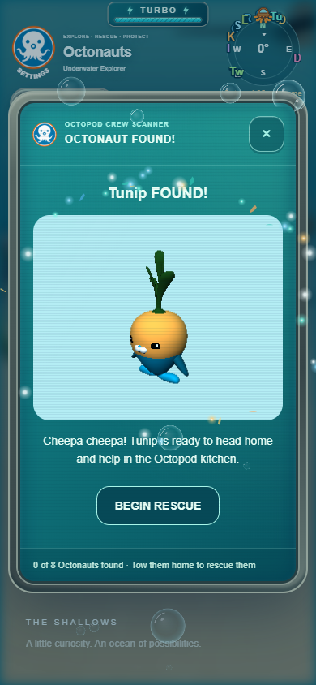
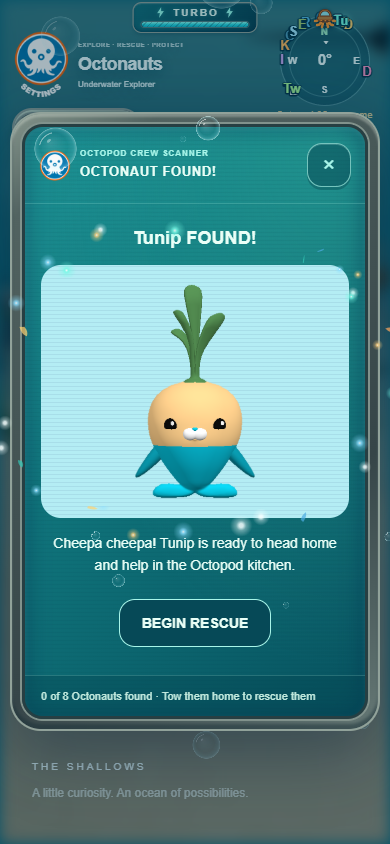
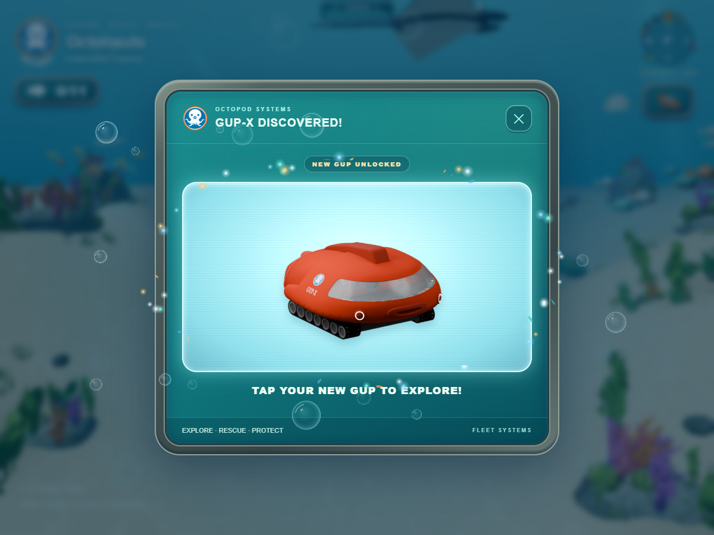
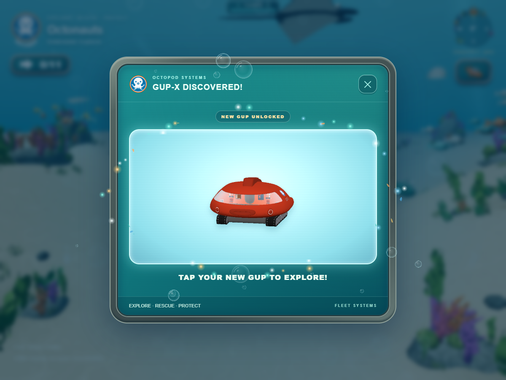
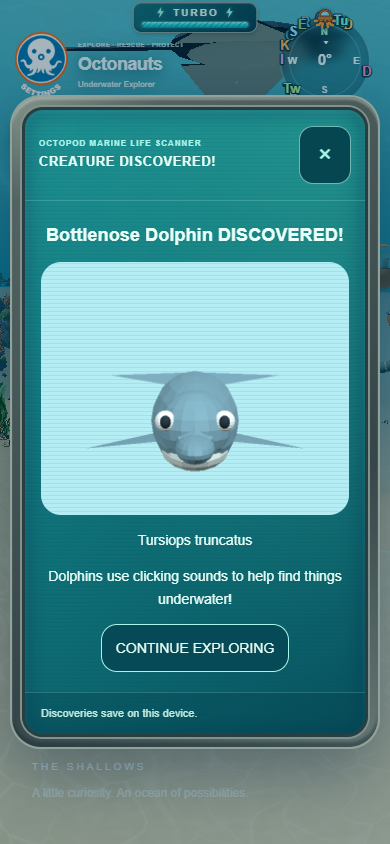
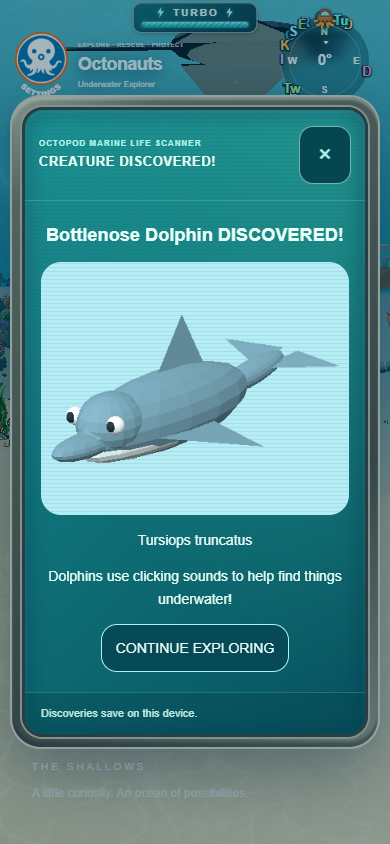
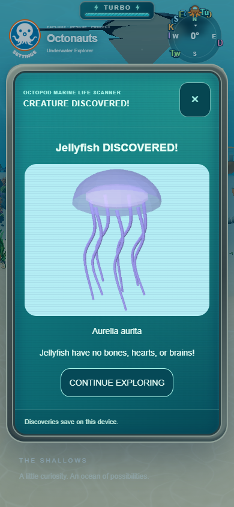
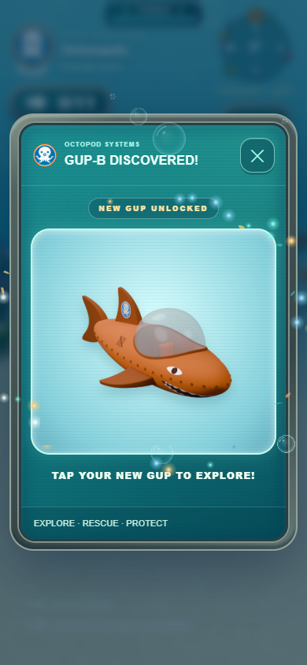
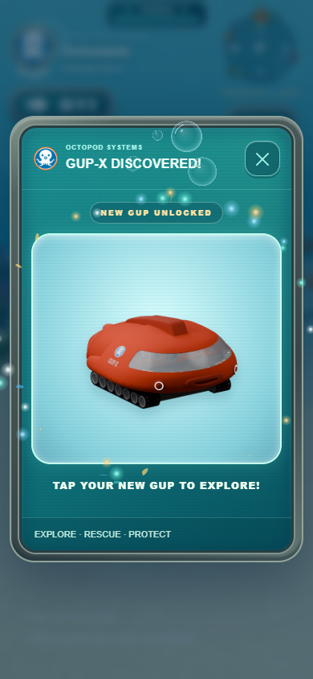

# Discovery presentation

The existing discovery previews are cached model-derived PNGs, not rotating live
viewports. Crew and marine previews already shared a render-target path; vehicle
discovery uses its original authored PNGs, preserving each vehicle's established
three-quarter angle and matching the carousel. The shared crew/marine path lives
in DiscoveryThumbnail.js and uses the existing renderer.

Scan lines and the light sweep sit behind artwork in isolated preview stacking
contexts. The monitor decoration remains behind content. Transparent image regions
still show the scanner background; original translucent materials remain translucent.
Bubbles, sparkles, sounds, buttons and discovery entrance animations remain intact.

Loaders retain native-axis corrections: imported crew use their existing pi asset
rotation; vehicle definitions and the marine adapter retain their orientation
metadata. The preview removes only the gameplay root pose. Its camera faces the
normalized front for crew. Marine creatures retain the original three-quarter
camera direction (x .8, y .4, z 1). Vehicle windows use their original authored
angles. The crew/marine orthographic camera fits all eight visual bounds corners.
Tunip, Barnacles and Peso show both eyes on opening. No GLBs or materials changed.

The offscreen texture explicitly uses sRGB before PNG readback, avoiding the old
linear-pixel PNG darkening. Neutral hemisphere, frontal key and gentle fill lights
replace the cyan-biased miniature lighting. No CSS brightness compensation, bloom,
new renderer or recurring render work is added. Targets are disposed immediately;
root transform, visibility, parent order and renderer state restore even on failure.
Vehicle discovery no longer generates a replacement preview or uploads model
textures for artwork; its existing selection/preparation flow remains intact.

## Verification

- 315 Node tests pass, including real-Three camera fitting, original material and
  orientation preservation, state restoration and failure cleanup.
- Production build passes with all GLB validations.
- Edge production-output browser checks cover Tunip, Barnacles, Peso, GUP-B, GUP-X,
  octopus, dolphin and translucent jellyfish at 1200x900 and 390x844.
- Loaded artwork, viewport fit and no page errors pass. For opaque models, pixel
  comparisons with scanner overlays enabled/disabled show no changed interior
  model pixels. Jellyfish retains translucent pixels. Detailed observations are
  in browser-results.json. World meshes, materials, texture samplers and clips
  retain their original ownership; no showcase rotation existed to alter.
- Existing celebration browser regression passes: single emissions, preserved
  layout, clear artwork/buttons, cleanup, reduced motion, hidden-tab suspension,
  touch selection and mute. The harness now observes the current found cue and
  waits for the existing five-second decoration lifecycle.
- Existing HUD/reward browser regression passes: earned GUP-X modal, selection,
  persistence, real rescue completion, message queue and infinite turbo.

Physical iPhone Safari, sustained on-device performance and listening remain
unverified. The original still-preview workflow is preserved; this change does
not introduce live animation or rotation into discovery portraits.

## Before and after

Tunip on a phone-sized viewport:

GUP-X on desktop:

## Marine preview correction

Marine life now uses its earlier angled view, while crew portraits remain
front-facing. Marine thumbnails alone use a tighter 94% fit and trim transparent
padding with a 3.5% safety margin. The resulting natural aspect ratio lets wide
animals fill the scanner width and tall animals fill its height without clipping,
stretching, changing the panel layout or increasing GPU render-target dimensions.
Character and vehicle preview framing, colors and layering are unchanged.

All 319 Node tests and the production build pass. Production Edge checks compare
all 11 marine species at desktop and phone sizes: each uses more space along its
longest visible dimension, all images fit the viewport, and no page errors occur.
The dolphin grows from 216x102 to 288x147 visible pixels on the phone test pose;
measurements for all species are in marine-framing-results.json. Tunip remains
front-facing. Physical iPhone Safari is still unverified.

## Vehicle angle correction

Only crew portraits remain front-facing. GUP discovery windows again display the
original model-derived vehicle PNGs through vehicleThumbnailURL, restoring their
per-vehicle authored angles and framing. Scanner overlays remain behind the artwork;
sounds, bubbles, controls, unlocks and selection behavior are preserved. The larger
angled marine previews are unaffected. The earlier GUP-X comparison above records
the previous iteration; the restored view is shown below.

The correction passes all 322 Node tests and the production build. Production
Edge checks cover all nine GUP images, three front-facing crew portraits and
three marine previews at desktop/phone sizes. Asset URLs match the original
vehicle PNGs, models fit their screens, and opaque artwork remains unaffected by
scanner overlays. Current observations: repair-browser-results.json. Helmet
fitting and Tunip's helmet exclusion are documented in ../tow-visuals.md.
