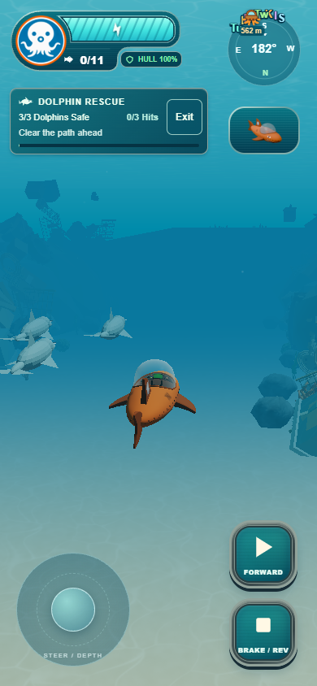
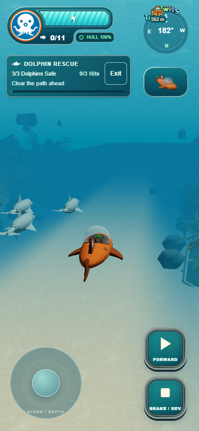

# Clearer Dolphin Rescue forward fog

The sandy route now uses 55% of the existing fog density within six metres of
its centerline. A smooth blend returns to full density at fourteen metres, so
the litter banks retain their existing underwater haze. The clear band follows
the straight route in world space, including during camera orbit; it is not a
screen overlay. Distance fog still thickens naturally further ahead.

`dolphinRescueConfig.environment.forwardFog` owns the four tuning values. The
mission temporarily extends the native Three.js fog shader on its existing mesh
materials, chaining sand/caustic/material hooks. Instanced positions are included
when finding world X. No new textures, geometry, draw calls, render targets or
render passes. Native particle/sky/surface shaders retain their existing fades.
Camera, dolphin route, GUP controls, gameplay and global fog configuration do not
change.

Every original material hook and program key is restored on exit or launch
failure before mission disposal. Stable per-material uniforms and a fixed cache
key support repeated entry without accumulating shader variants. Shared reef,
sand and GUP materials are not cloned or disposed.

## Verification

- `node --test tests/*.test.js`: all 414 tests pass, including new smooth-band,
  side-preservation, native shader chaining, instanced-coordinate, uniform reuse,
  hook restoration and custom-shader exclusion checks.
- `python tools/build.py`: production build, GLB checks and import versioning pass.
- `git diff --check`: passes.
- Actual production Edge software WebGL: low/high, 1280x800, 390x844 and 844x390
  before/after captures. The center probe changes visibly (RGB difference sum
  142 low / 144 high); side-bank probe pixels are byte-for-byte identical.
- Render calls and triangle counts are identical before/after at every viewport.
- Three leave/relaunch cycles restore original hooks and free-roam fog. Program
  and geometry counts remain stable: 95/744 low and 99/798 high in these tests.
- Additional low-quality repeat-entry checks confirm the shared sand shader's
  fog uniforms still update after cached shader reuse. No page errors.

Evidence: [low results](low-results.json), [high results](high-results.json).
Optional harness: tests/dolphin-fog-browser.cjs, using existing Playwright via
NODE_PATH, CHROMIUM_PATH for Edge/Chromium, DOLPHIN_TEST_URL for the served
production directory and FOG_QUALITY=low/high. No dependencies were installed.

Single agent under the continuing mission instruction; no independent agent QA.
Physical iPhone Safari and sustained native GPU performance remain unverified.
