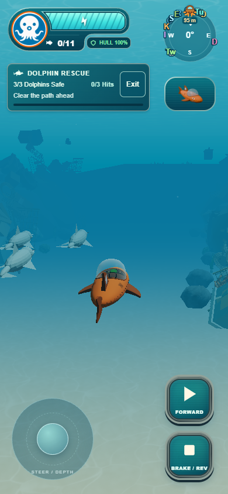
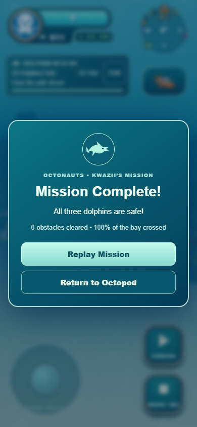
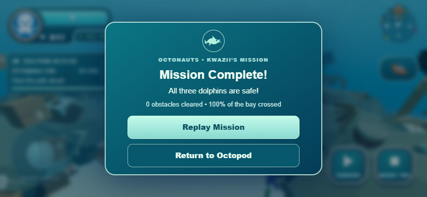

# Dolphin Rescue UI and reef polish

Single-agent implementation, as requested. The existing mission, camera and
movement systems remain in place. No subagents or independent agent QA ran.

## Changes

The mission panel is now a compact 244 px card beneath the top-left GUP status
assembly, rather than in the centered notification lane. It shows the mission,
3/3 dolphins, hits, objective, progress and a 44 px Exit target. At 320 px it uses
a narrower 190 px layout to clear the vehicle selector. Existing safe-area and
viewport handling are reused.

The shared briefing, success, failure and exit dialog now explicitly overrides
the global control-button dimensions. Actions fill equal available widths,
remain on one line, and have at least 46 px touch height. The dolphin emblem,
mission text, statistics and action handlers remain; short screens can scroll.
The normal completion label is Replay Mission.

The bay retains the actual `OceanTerrain.material`, including sand-color.jpg,
sand-normal.png, sand-roughness.png, caustics and existing lighting. Its UVs now
use the same 2.4 m scale and noise-driven sand coloring as free roam, with a
lightweight subdivided flat plane. All floor vertices remain at Y=0.

Scenery instances borrow the already loaded free-roam low-detail geometry and
materials for rock0, branch0, brain0, tube0 and kelp0 from
assets/models/underwater-environment.glb. No new models, texture downloads or
per-instance simulation were added. A separate seeded placement stream keeps
existing litter placement and gameplay random sequences unchanged. The rubbish
banks remain dominant; reef clusters line their bases and outer sandy edges.
Seven low rock formations use the existing static ellipsoid collision pattern.
They are environment scenery, never mission debris or dolphin penalty objects.

The existing FogExp2 atmosphere accepts an optional underwater density, restored
on exit or launch failure. Dolphin Rescue uses 0.024, approximately 90% fade at
60 m and 97% by 80 m at the observed camera depth (depth/day/night blending still
applies). The water color, lighting, sky transition and particle/ray integration
remain shared. No postprocessing or second fog system. Chunk visibility is
bounded at 100 m, beyond the useful fog range.

The mission uses a session-only instance of the existing VehicleDamage system:
launch and replay start at 100% GUP-B Hull, including when entering with zero
Hull. Existing emergency state and display refresh normally. Return restores the
original fleet damage object and exact Hull values; mission health does not write
or heal the free-roam save. Existing mission collision damage rules are unchanged.

## Clearance and lifecycle

All scenery is capped at 5.5 m; actual rendered source-mesh box corners reach
5.393 m on low and 5.407 m on high in the tested deterministic layouts. The
unchanged dolphins swim at 11 ± 0.14 m with a 0.75 m collision radius, leaving
over 4.7 m of vertical clearance above the tallest scenery. Actual transformed
mesh bounds stay at least 6.8 m from the centerline; dolphin horizontal movement,
formation, speed, bobbing and following logic are unchanged.

There are 271 scenery instances on low and 403 on high, in spatial batches, with
only seven new static proxies. A controlled spawn view adds 18 draws/85,658
triangles on low and 20 draws/145,380 triangles on high compared with hiding the
reef batches in the same scene. These are renderer counts, not FPS benchmarks.
Instancing buffers are disposed on exit; borrowed geometry, materials, textures
and the sand material are never disposed. Three launch/exit cycles per quality
return renderer geometry counts to the same baseline (743 low / 797 high), with
no retained bay group or disposal of shared resources.

## Verification

- Node 24.22.1: `node --test tests/*.test.js`: 403 tests pass, including two new
  deterministic placement/full-route clearance regressions.
- `python tools/build.py`: production build and GLB/import versioning pass.
- `git diff --check`: passes.
- `tests/dolphin-polish-browser.cjs`: actual production Edge software WebGL,
  low/high, 390×844, 430×932, 844×390, 1280×800 and extra 320×568; repeated
  portrait/landscape changes, no HUD/control overlap or overflow, equal-width
  single-line modal actions, restart, scripted success/failure, full mission Hull,
  unchanged fleet storage, world/camera/fog restoration and owned-resource cleanup.
- `tests/dolphin-touch-browser.cjs`: actual emulated touch with continuous game
  loop verifies heading follow, joystick/Forward in both finger orders, release
  and orbit recentering. Rendering is suppressed during touch timing measurements.
- No page errors in these checks. Screenshots were inspected by the main agent.
  One combined capture retry timed out during high-quality free-roam startup
  in software WebGL; the high-quality run then passed in a fresh browser process.

Run the optional browser checks with existing Playwright tooling via NODE_PATH,
CHROMIUM_PATH pointing to Edge/Chromium, and DOLPHIN_TEST_URL pointing to the
served production directory. No dependency installation is needed. Raw results:
[browser-results.json](browser-results.json),
[touch results](../dolphin-rescue/touch-results.json).

Physical iPhone Safari, real safe-area behavior, sustained native-GPU FPS and a
full manual 150-second escort are unverified. Automated clearance and scripted
completion establish route safety, not subjective gameplay difficulty. Coral
uses existing low-detail free-roam assets on both graphics settings to bound cost.

## Files

Runtime changes: src/missions/DolphinRescue.js, src/missions/DolphinBay.js,
src/missions/dolphinSceneryLayout.js, src/config/dolphinRescueConfig.js,
src/ui/dolphinRescue.css, src/environment/UnderwaterAtmosphere.js.
Checks: tests/dolphin-scenery.test.js, tests/dolphin-polish-browser.cjs.
Coordination/evidence: BACKLOG.md, docs/dolphin-rescue/README.md,
docs/dolphin-rescue/touch-results.json and this directory's report, screenshots
and browser-results.json. Unrelated existing HUD preview PNGs are untouched.
