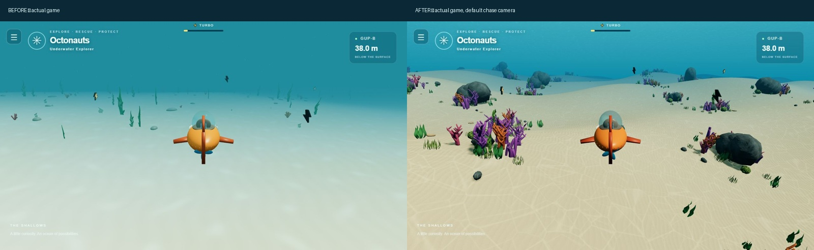

# Environment visual upgrade — October 22, 2026

The supplied concept image is the artistic target. It was inspected alongside real game captures, not treated as a guaranteed Three.js result. The concept itself is not redistributed in this repository.

## Before and after: actual gameplay



The comparable original was captured from the still-live pre-upgrade game before publishing. Both comparison frames use the default 14.4 m distance / 4 m height. The separate `before-chase.png` is the initial workspace inspection, which inherited the prior 22 m / 8 m test preference. No generated illustration is used as gameplay evidence.

## Visual review and iteration

| Pass | Actual screenshot | Finding and next correction |
| --- | --- | --- |
| Original | [Default original](before-default-chase.png) | Very little readable relief, smooth pale floor, thin repetitive plants and uniform cyan light. |
| Terrain and sand | [Phase 1](phase1-terrain.png) | Dunes and sand maps appeared, but high ambient illumination obscured the terrain shape; caustics were too polygonal. |
| Authored reef library | [Phase 2](phase2-reefs.png) | Rock/coral pockets made the space more legible; needed fuller coral branches, closer foreground pockets and better rock materials. |
| Light/material refinement | [Phase 3](phase3-lighting.png) | Directional contrast, blue distance fog, rock normals and contact shading improved depth; caustic strength was reduced and the texture warped. |
| Final chase | [Final chase](after-chase.png) | Open sand route framed by fuller multicolored reef clusters, readable dunes and fine directional sand ripples. |
| Elevated terrain | [Elevated](after-elevated.png) | Uses the existing camera sliders (30 m behind / 20 m high) to inspect dunes and placement. |
| Near-ground detail | [Close view](after-close.png) | Actually piloted to a reef and used drag orbit with the existing close camera. Tube openings, folded kelp, grooved brain coral and normal-mapped sand are visible. |
| Wide atmosphere | [Wide view](after-wide.png) | Existing 40 m / 6 m camera shows broad sandy channels, distant reef pockets, blue fog and the suggested surface. |
| Reduced profile | [Low profile](after-low.png) | Retains the terrain, materials, caustics and main composition using reduced meshes and no shadow map. |

Two stationary game frames were also compared over an unobstructed sand region. The mean RGB difference was about 2.54/255, confirming the animated light pattern changes on the seabed, independently of HUD and vegetation motion. See `caustics-second-frame.png` versus `after-chase.png`.

## Implementation

- Seamless 100 m procedural terrain chunks with broad shelves, medium cross-current dunes and a winding sandy valley. Shared world-space height sampling and analytic normal samples prevent chunk-edge normal seams.
- Authored seamless 512px sand color, normal and roughness textures; directional fine ripples and grain. No external texture downloads or enormous maps.
- Surface-following animated caustics use two warped, drifting samples of a seamless light network, shaded on the real terrain geometry.
- Dedicated `assets/blender/underwater-environment.blend` contains 24 reusable variations: orange/pink/purple branching coral, grooved brain coral, hollow tube colonies, folded kelp, short seaweed, grass patches, lumpy rock outcrops and spiral/scallop shells. Every variation has a decimated mobile/distant mesh. Native materials and vertex-color crevice shading are retained.
- `assets/models/underwater-environment.glb` is about 2.95 MB. The original 3 legacy environment libraries remain in the repository for history but are not loaded or copied into production.
- Seeded reef pockets cluster coral, vegetation and stones around rocks. Larger outcrops favor higher terrain; the starting channel stays open. Sparse shells and stones occupy otherwise open sand.
- Blue depth fog, a warm directional sun, lower blue-green ambient illumination, a simple surface suggestion and gradient sky dome. High quality adds a local 1024px sun shadow map; low quality retains baked contact shading without shadow-map cost.
- Geometry is shared and instanced by asset variation. Individual instances outside the camera frustum or effect radius are skipped; only nearby pieces use full geometry. Vegetation sway runs in the vertex shader.

## Rendering profiles and measured limits

`src/config/environmentConfig.js` controls texture/shading tuning, terrain detail, placement and quality profiles. Coarse-pointer devices automatically choose low. Append `?quality=low` or `?quality=high` to compare; this adds no gameplay menu. Sustained frame pressure lowers pixel ratio toward 0.85 without changing movement timing.

Measured at the 1280 × 720 desktop app-browser viewport, device pixel ratio 1, default chase view:

| Profile | Draw calls | Triangles/frame | Median frame interval | P95 frame interval |
| --- | ---: | ---: | ---: | ---: |
| High | 141 | 1,381,114 | 7.0 ms | 7.0 ms |
| Low | 116 | 956,622 | 7.0 ms | 13.9 ms |

These are sampled desktop animation-frame intervals, not GPU timings or an iPhone benchmark, and do not guarantee device frame rates. JSON snapshots are retained alongside this report. Use `?inspect=1` for hidden DOM-only QA telemetry; nothing extra appears in the normal HUD.

Real iPhone Safari frame rate, thermal throttling, portrait/landscape and sustained multitouch still require testing on an actual iPhone. The reduced profile and adaptive resolution are implemented, but target-device acceptance is not claimed.

## Verification

- `node --test tests/*.test.js`: 20 passing tests, including existing movement, turbo, volume limits and camera preference regressions; plus reef variation/LOD integrity, seeded placement, terrain relief/smoothness and bounded texture dimensions.
- Production build and 15-file HTTP check, including the new reef GLB and all six texture files under a non-root subpath.
- Actual high/low browser scenes inspected without console warnings/errors. Forward thrust, steering, descent, orbit and camera settings exercised while taking the required views.
- Blender library/detail renders inspected repeatedly before integration. Branches were rounded and thickened; the first sharp brain-coral displacement was softened into readable folds.
- Vehicle model, input mapping, movement/turbo parameters, camera behavior and saved preferences were preserved. Existing turbo pickups remain; no new gameplay system, mission, collectible type, menu, vehicle or creature was added.

## Remaining difference from the concept

This is a substantial stylized real-time improvement, not a photorealistic match to the concept. The reference has finer sculpted coral detail, denser organic variation and cinematic volumetric sun shafts. This implementation uses reusable mesh variations, texture caustics and a simple surface/sky suggestion rather than path tracing or true volumetric scattering. Those choices keep the web/iPhone rendering budget practical. The before/after and all four gameplay views show the actual result.

## Regeneration

From the repository root:

```sh
# Texture authoring only; Pillow and NumPy are needed for regeneration.
python tools/create_sand_textures.py
blender -b --python assets/blender/scripts/create-underwater-environment.py
python tools/build.py
node --test tests/*.test.js
```

The Blender generator saves the editable origin-centered mesh library and GLB before arranging a separate temporary preview studio. The `.blend` is the editable asset source; the GLB is the runtime asset. Studio renders are explicitly labeled `blender-*` and are not substituted for game screenshots.

## Public deployment verification

Published to https://kevinmejia.github.io/Octonauts-Oceanbound/ and inspected in the actual browser on October 22. High and low public scenes loaded without console warnings/errors; all 15 production HTTP checks passed, including runtime models and textures. The deployed build uses versioned module and asset URLs. [Actual live chase screenshot](live-chase.png). Target-device iPhone benchmarking remains outstanding as described above.
