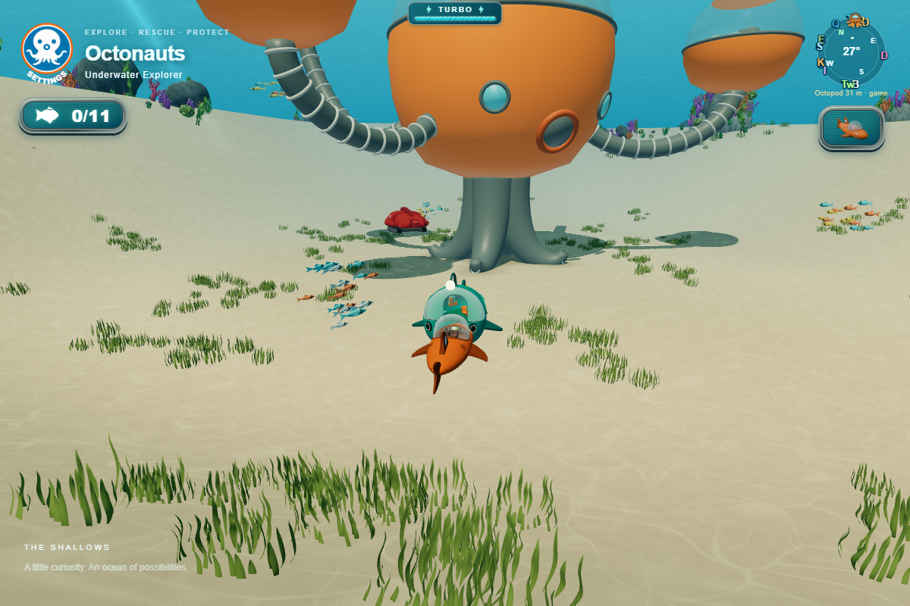
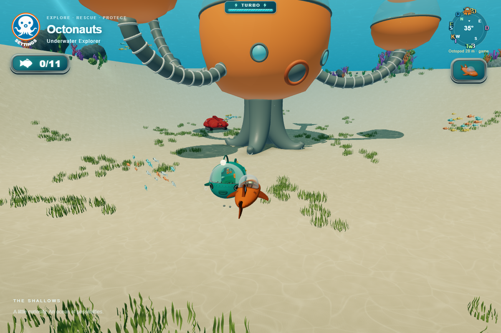
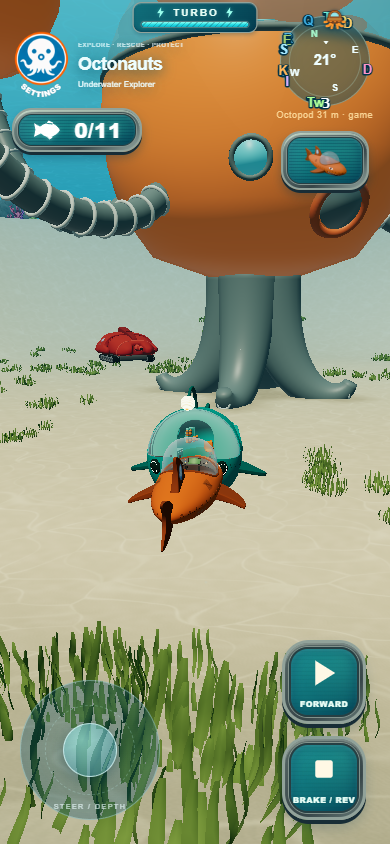
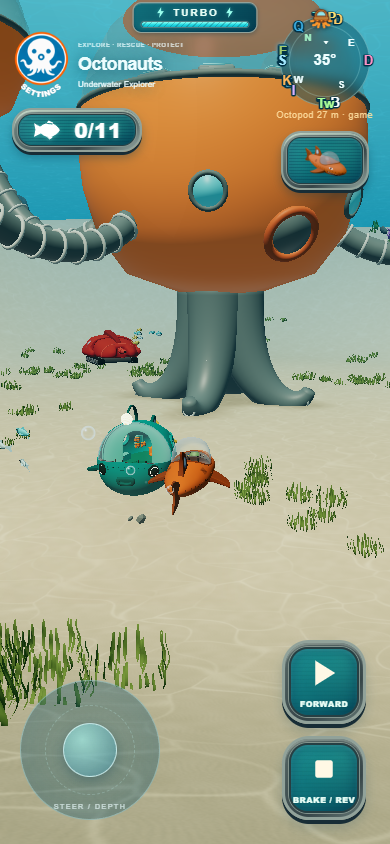

# Pushable parked GUP prototype

Unlocked parked GUPs slide and turn slightly when hit by the player. Hull size
provides approximate mass; tracked GUP-X has additional weight. Drag settles the
vehicle, then its motion sleeps. Only nearby, awake records receive integration.
Positions persist through vehicle switches in the session and reset on reload.

The implementation reuses collision contacts, compound hull proxies, terrain
support, fleet poses and the spatial grid. Model and collider positions update
together. World obstacles, other parked GUPs and the active player block movement;
there is no chain impulse transfer or full rigid-body simulation. Existing proxy
shapes approximate the meshes. No new meshes, particles, dependencies or persistent
storage writes are introduced. Tuning lives in src/config/parkedVehicleConfig.js.

## Verification

- 331 Node tests pass, including nine motion tests covering mass, cooldown,
  damping, yaw, sleeping, locked/active eligibility, terrain, walls, player overlap,
  grid synchronization, session reset and eight parked vehicles settling.
- Production build passes with GLB validation; git diff whitespace check passes.
- Actual Edge/WebGL gameplay with keyboard collisions passes in high-quality
  desktop and low-quality phone-sized viewports: B pushes A, B pushes X, X pushes B.
  All targets settle; model identities and grid proxies remain synchronized;
  switching preserves displacement and reloading restores berths. No page errors.
- Motion-update CPU median was approximately 0.1 ms, P95 0.1–0.2 ms across these
  desktop Edge runs. This measures this subsystem while awake, not whole-frame
  cost, GPU time or physical iPhone performance. Physical Safari remains untested.
- Single-agent implementation and verification; no independent agent QA.

Reproduce with `node --test tests/*.test.js`, `python tools/build.py`, and
`node tests/parked-vehicle-browser.cjs` with Playwright available through NODE_PATH
and a source server on port 5173. PARK_TEST_URL can select another server.
Browser results are in [results.json](results.json). Different frame timing changes
contact duration, so displacement measurements are illustrative, not benchmarks.

## Desktop before / after

## Phone-sized viewport before / after

