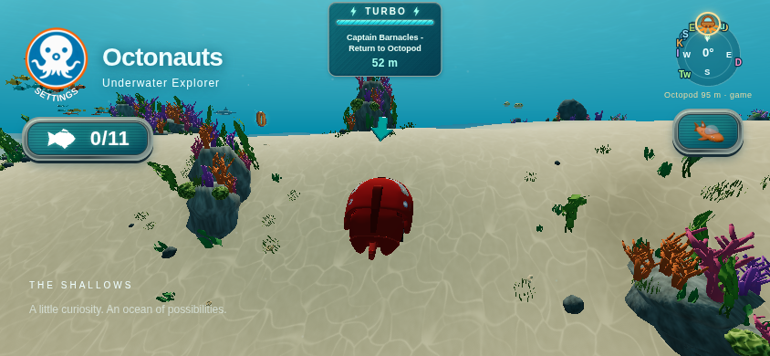
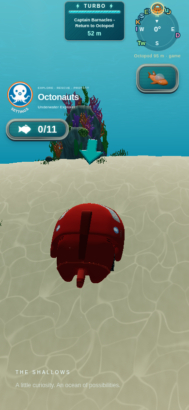

# World-space rescue direction arrow

## Placement and direction

`RescueNavigation` previously rendered the existing arrow in a miniature HUD
scene/camera and copied that viewport into a canvas inside Turbo. That architecture
could not place it over the active GUP. It now attaches the same loaded arrow and
one reusable pivot to the existing ocean scene. The world renderer draws it with
the rest of the scene; the miniature camera, viewport/scissor pass, canvas copy,
and duplicate HUD arrow are removed. The existing mission caption, distance,
Turbo charge meter, and compass emphasis remain.

The marker's horizontal offset uses only vehicle heading, along local +Z forward.
Vehicle translation feeds forward directly while the heading-relative offset is
exponentially damped. This keeps the marker connected and ahead even at GUP-X
27.36 m/s turbo speed; interpolating an absolute world position would trail behind
by several metres. Reverse travel does not flip the forward convention.

Height is measured above the highest point of the existing oriented collision
hull, including its center offset, pitch, and roll. This is clearance accounting,
not inherited arrow rotation. World Y is damped to reduce uneven-terrain bobbing;
a minimum safe gap prevents rapid ascent or synthetic flight from pulling the
hull through the marker. New missions and active-vehicle changes reset placement
at zero delta time instead of easing from a previous vehicle's pose.

The GLB and fallback point along local -Z. Their yaw follows the absolute bearing
from the actual rendered arrow position to the Octopod, not the vehicle-relative
bearing. Shortest-angle exponential damping handles either angular seam without
spinning. Coincident horizontal arrow/target positions retain the prior bearing.
The navigation anchor keeps pitch and roll zero with a world-up reference.
A separate intrinsic presentation tilt exposes the existing cyan face, as described
below. HUD distance still measures
the original 3D vehicle-to-docking-center distance; rescue delivery thresholds,
progress, towing, and controller physics are unchanged. No camera code changes.

## Readability and paused rendering

A horizontal arrow face became an ambiguous thin bar on the GUP-X uphill camera
in phone-sized views. The same GLB now has one presentation group under its
yaw-only anchor. Immediately before the existing ocean render, camera position
supplies a world-up reference for a bounded, smoothed tilt; camera roll and hull
rotation are never copied. The face normal stays within 25 degrees of world up.
The intrinsic rotation is composed as Rx(pitch) * Rz(roll): local -Z retains its
horizontal direction, so exposing the broad cyan face does not falsify the
Octopod bearing. It is still a world-space model, not a replacement icon or a
camera-attached billboard. Its visual inclination is not a vertical elevation cue.

The GLB's cached box extents provide a conservative vertical support lift after
tilt. This keeps the actual mesh underside above the hull even during a rapid
ascent; the calculation uses scalar math rather than scanning vertices per frame.
Presentation is prepared after the chase camera updates, inside the existing world
render path, without changing the camera system or adding a render pass.

Mission changes and disposal notify a narrow invalidation callback connected to
Game.needsPausedRender. Stop, reset, and completion therefore clear the last arrow
pixels on the next paused-world redraw as well as hiding the object immediately.
Normal follow updates do not repeatedly dirty paused rendering. Browser viewport
checks wait for resize/frame settlement before posing and rendering, then wait for
presentation before capture; an early resize can otherwise clear a rendered frame.

## Configuration and resources

`rescueConfig.navigation` contains:

| Setting | Default | Meaning |
| --- | --- | --- |
| `height` | 1.8 m | Desired vertical gap above the oriented hull top |
| `forwardOffset` | 1.8 m | Desired horizontal heading offset |
| `scale` | 1.5 | Uniform world-space arrow scale |
| `positionSmoothing` | 10 /s | Offset and world-height exponential response |
| `rotationSmoothing` | 12 /s | Shortest-bearing exponential response |
| `minClearance` | 0.6 m | Minimum mesh/hull gap during rapid upward movement |
| `presentationTilt` | 55 degrees | Maximum face-normal departure from world up |
| `presentationSmoothing` | 12 /s | Intrinsic readability-tilt response |

Height defines the desired base clearance; a bounds-derived lift compensates for
the tilted model extending below its origin. These are world units and response
rates, not fixed screen pixels. Position may
briefly differ from the desired height while it damps a descent; upward safety
clearance takes priority over smoothing. Like other world geometry, screen size
varies with camera distance and aspect. No new particle effects or UI are added.

Runtime asset `assets/models/rescue-arrow.glb` remains unchanged: 13,920 bytes,
192 triangles, four material primitives, no textures, animations, or skeleton.
Its cyan upper face, dark teal sides/underside, bevels, and emissive material
properties are preserved. Loading failure retains the original procedural fallback.
The frame path reuses its position, navigation output, pivot, geometry, and
materials; it creates no vectors, navigation objects, render targets, or renderers.

`RescueSystem` still owns mission state. Navigation becomes visible after the
first positioned update during an escort and hides synchronously on stop, reset,
or completion. The same pivot is reused across missions and vehicle switches.
Disposal removes the owned pivot and HUD section and releases only arrow resources;
it never clears, traverses for disposal, or disposes the ocean scene or its lights.

## Developer verification

- `node tests/rescue-arrow.test.js`: 15 production-class/real-GLB cases pass.
- Coverage iterates all nine registered GUPs, compares oriented hull clearance
  against transformed box corners, verifies the actual -Z model convention and
  unchanged colors, and checks absolute direction independently of heading.
- Turbo/reverse and continuous sharp turns retain positive forward placement with
  no horizontal translation lag. Uneven slopes, fast ascent/descent, and synthetic
  flight retain minimum clearance while high-frequency bumps are damped.
- Configurable response, 30/120 Hz convergence, angular seams, coincident bearing,
  zero-time mission/vehicle reset, resource reuse, immediate stop/reset/completion,
  and owned-only disposal are covered. Real `RescueSystem` methods are exercised
  with fixture game effects, not a replacement rescue implementation.
- New regressions project the actual GLB cyan triangles in 844×390 and 390×844
  views, including the GUP-X uphill edge-on case. All nine vehicle profiles retain
  a projected glyph minimum dimension above 8 pixels and cyan-face area above
  100 square pixels in those configured cases; these are geometry assertions,
  not physical-device or lighting measurements. Actual model tip bearing,
  conservative mesh underside clearance, world-up tilt bounds, camera-roll
  independence, and presentation frame-rate behavior are also checked.
- Event-only invalidation is verified for start, stop, reset, completion, and
  disposal, with no callback during ordinary follow updates.
- `npm test`: all 56 test files pass. `npm run build` and `git diff --check` pass.
- The existing optional `tests/rescue-navigation-browser.cjs` harness is updated
  for world placement, actual vehicle switching, cardinal bearings, viewport
  captures, completion/reset/cancellation, and safe disposal. It was not executed
  by the implementing agent. Set `NAV_TEST_BROWSER` to an installed Chromium path,
  or `NAV_TEST_CHANNEL` for a supported Playwright channel; `NAV_TEST_URL` selects
  the source or production base URL. Existing local Playwright tooling is needed.

Independent QA and actual rendered observations are reported by the coordinator.
Ocean lighting and ordinary world-geometry occlusion now apply to the arrow;
the bounded tilt improves grazing-view readability but does not guarantee every
custom camera setting or ordinary scenery occlusion is resolved. Automated
geometry does not establish visual readability, physical iPhone Safari behavior,
multitouch, or sustained mobile performance. GUP-X remains ground-bound; airborne
coverage is synthetic and does not introduce a jump mechanic.

## Rendered verification

The coordinator ran the real game and original arrow GLB in headless Chromium
with software WebGL. Scripted all-nine-vehicle switching and escort lifecycle
checks passed. Final captures cover GUP-B facing toward/away from the Octopod,
GUP-X uphill/downhill, and landscape/portrait phone-sized viewports. The actual
model tip's horizontal bearing matches the target, with approximately 1.8 m mesh
clearance in these settled poses, one reused arrow, no HUD canvas, and no page
errors. Paused cancellation hides the object and invalidates the next world render.
Raw final observations: [browser-results.json](rescue-navigation/browser-results.json).

These are controlled browser poses and viewport captures, not physical iPhone
or complete manual mission playthroughs. Manually check iPhone Safari readability
while steering/orbiting, sharp slope transitions, rescue completion/cancellation,
all vehicle sizes, and sustained frame pacing. Synthetic airborne cases do not
add a GUP-X jump mechanic.

## Local merge resolution

The presentation tilt is now capped at 25 degrees as requested. The incoming
world-space arrow is retained alongside the local GUP-X discovery queue, compact
performance display, and queued turbo-panel rescue messages. The historical
captures above predate this tilt adjustment.
