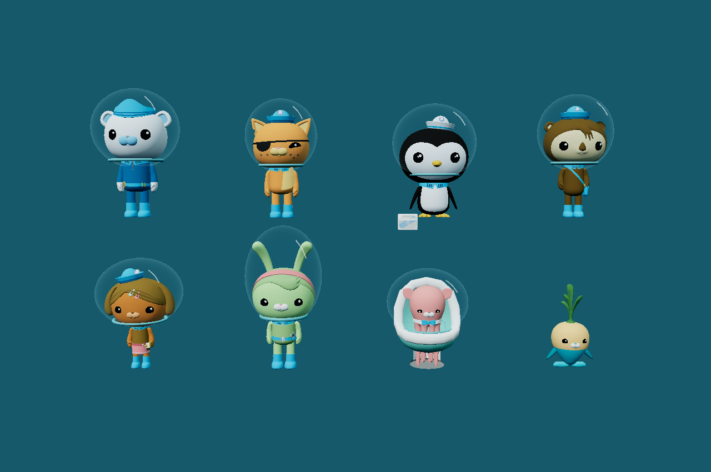

# Rescue towing visuals

Towing blends the characters into a nearly horizontal, head-first swimming pose, with one arm reaching toward the rope and the other trailing alongside the body. The pose holds even when the GUP stops. Rotation pivots around the rescue chest rather than the feet, with gentle body motion and a faint bubble/streak trail. Rescue motion, physical attachment, speed penalties, delivery, and saved progress remain controlled by the existing rescue system. After posing, the visible rope endpoint follows the leading hand; this does not move the physical passenger or change the rope's simulated length.

`src/crew/TowPose.js` restores its previous overlay before the animation mixer updates, then blends the towing pose onto the current animation. Independent hand controls receive the same shoulder transform so hands and attached accessories remain connected. The existing assets have no usable walking/towing animation sequences; their base poses are preserved. Flippers and Inkling's front tentacles use their existing bones with gentler weights.

`src/effects/TowWater.js` samples actual passenger movement and reuses the propulsion water shaders. One fixed particle pool (40 particles, or 24 on low quality) provides bubbles and thin flow streaks. Emission stops while stationary, clears on recovery jumps or release, and is culled beyond the configured camera distance. No external textures or dependencies are needed.

Tune `src/config/towVisualConfig.js`:

- `pose.enabled`, blend/release speeds, reach direction/weight, body pitch/bob/roll.
- Per-character rig names, shoulder/tip bones, independent hand followers, and reach weights.
- `water.enabled`, particle budgets, emission rates, movement threshold/full speed, opacity, lifetime, render distance, and recovery jump threshold.

Validation: `node --test tests/*.test.js`, `python tools/build.py`, and `node tests/tow-visuals-browser.cjs` (with Playwright installed). The browser check exercises all eight rigs, hand continuity, bounded resource use, desktop/mobile rendering, normal rescue delivery, and restoration of the original pose.

## Underwater helmets

`src/crew/CrewHelmet.js` measures the upper part of each existing model once and adds a lightweight clear bubble, neck seal and reflection under its motion root. Measurement happens after gameplay dimensions and portraits are determined. Helmets follow the towing pose, appear for crew outside the Octopod below the water surface, and hide for rescued crew in the pod. Saved progress and reset reuse the existing crew synchronization. Geometry and materials are released with the crew.

`src/config/crewHelmetConfig.js` controls helmet enablement, padding and each character's head fitting cutoff. `node tests/crew-helmets-browser.cjs` checks all eight characters (seven helmets, with Tunip excluded), saved rescue reloads, resets and unchanged gameplay dimensions.

## Helmet fitting regression repair

The discovery thumbnail renderer now restores its original parent's world matrix
before refreshing the character's attached skin bind inverses. Previously, the
first character's inverse could still describe the thumbnail coordinate frame
while helmet measurement used the translated Octopod frame. Barnacles' fitted
horizontal radius became about 110 metres, turning its neck seal into the large
teal strips visible across the seabed.

CrewHelmet also refreshes attached SkinnedMesh inverses before reading posed
vertices, so fitting stays local under translated, rotated or scaled parents.
Only cached transforms are refreshed; model geometry, materials, gameplay bounds,
rigs, towing and rescue progress remain unchanged. Tunip explicitly opts out via
crewHelmetConfig.characters.tunip.enabled=false. It allocates no visor, collar or
reflection geometry, including after reset or reload.

322 Node tests and the production build pass. Regression fixtures cover stale skin
inverses and Tunip's opt-out. Production browser checks verify seven fitted helmets,
no Tunip helmet, rescued visibility, saved reload/reset and unchanged dimensions.
The existing towing browser suite also passes hand/rope continuity, bounded water,
pose release and real delivery. Physical iPhone Safari remains untested.

