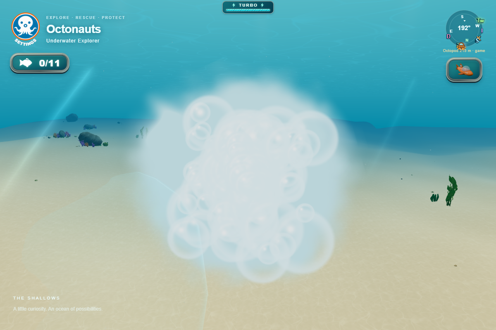
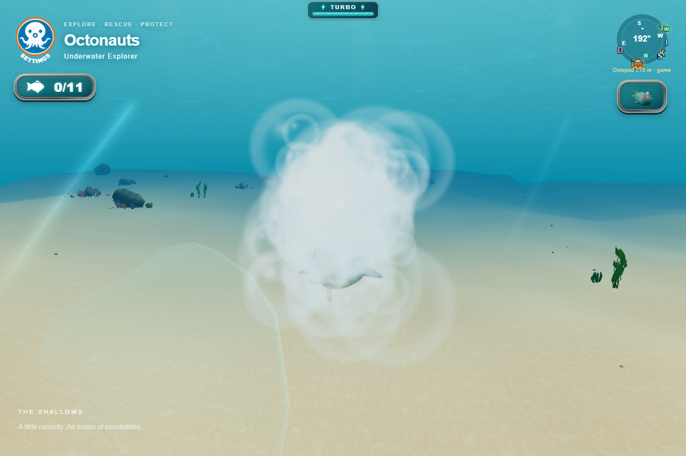
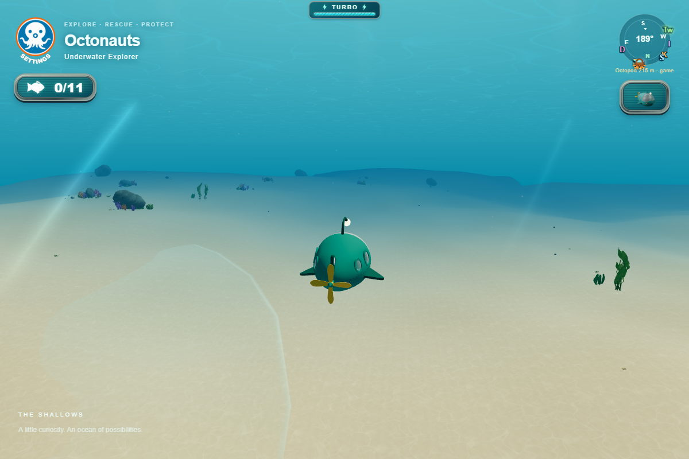
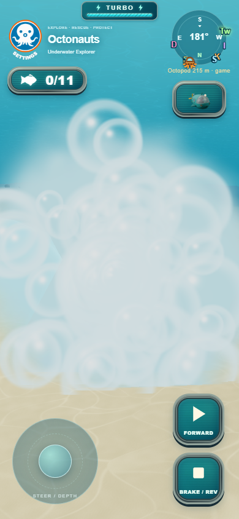
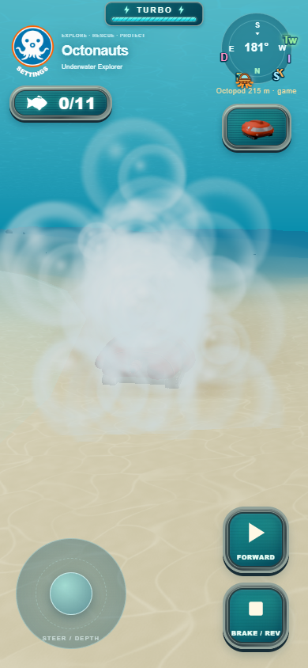
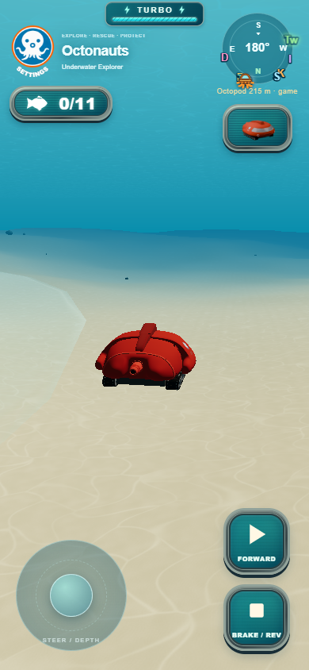

# GUP bubble-and-sand transformations

Carousel confirmation now prepares the next model, textures and shaders while
keeping the current GUP intact. The existing selector closes, then a 1.4-second
world-space bubble cloud builds around the outgoing and normal safe-switch poses.
The atomic fleet install occurs at 0.4 seconds, under the dense cloud. Vapor clears
first, then buoyant bubble shells and ground sediment fade as the new GUP emerges.
Same-vehicle selections, ordinary carousel browsing and discovery-window selection
do not trigger the effect.

## Focused integration

VehicleFleet.select has an optional pre-install cover hook after preparation; its
existing generation, availability and cancellation checks still guard installation.
The selector keeps its pending operation across the normal 180 ms close, blocks
reopening during transformation, and owns only its own effect. A cancelled slow
selection cannot cancel or unlock a later selection. Failed loading keeps the
current GUP and existing retry UI. No physics, controls, unlock saves, assets,
vehicle preparation policies or safe spawn-placement rules were changed.

VehicleTransformation reuses ParticlePool, stepBubble, stepParticle, the existing
propulsion bubble fragment shader and the existing sediment billboard shaders.
Bubble shells use instanced quads with UVs in place of point coordinates so large
bubbles are not limited by mobile point-size caps. Soft core vapor hides the swap;
camera-side shells avoid silhouettes from opaque hull depth through transparent
particles. Terrain height and the existing hullFloor support function determine
near-ground eligibility and actual sediment origins. Sediment spreads with drag,
then settles against the sampled seabed. Ordinary world particle caps are untouched.

Only two temporary instanced batches draw: 80 bubbles / 24 clouds in low quality,
128 / 36 in high quality. Typed buffers, geometry, materials and particle records
are reused across switches. Idle batches have zero count, no live particles and
visible=false; there are no timers or a second animation loop. Owned resources
can be disposed explicitly. No extra full-scene render is added on the swap frame.
The effect acquires/releases one existing pause token and clears held input.
Other menus, hidden tabs and context recovery retain the game's pause behavior.

The existing chase camera continues updating during the brief pause. Its ordinary
collision/terrain safety remains active; only the one-time profile snap is avoided
during a transformation. No new camera controller or shake was introduced.

## Verification

- All 318 Node tests pass, including preparation-before-cover, cancellation,
  same-selection bypass, terrain-based sediment, quality budgets, timing, pause
  ownership, reuse, cleanup and GPU disposal.
- Production build passes, including GLB validation and versioned modules.
- Edge tested production output in low/mobile and high/desktop profiles: 22
  scripted transitions covering all nine GUPs, different sizes, GUP-X in both
  directions, seabed and high-water switching, plus real animation-loop transitions
  followed by movement input. Phone captures include portrait and landscape.
- At 0.38 seconds the outgoing vehicle is still selected, and comparisons against
  the same frame with that vehicle hidden confirm at least 98.1% attenuation of
  its pixel contrast across these test poses (99.5% for desktop). This measures
  actual concealment, not just particle counts. The new ID appears after cover.
- All captured cases return to zero particles, hidden batches, released pause and
  enabled selector. Geometry IDs remain unchanged across repeated switches. Same
  selection, duplicate confirmation and preparation failure checks pass. No page
  or shader errors were observed. Summary: browser-results.json; the optional
  browser harness recreates full observations and phase screenshots locally.
- A separate production browser regression gates a slow GUP-A preparation, cancels
  it, starts GUP-R, then releases the obsolete load. The newer transformation stays
  active and finishes correctly with controls and pause released.

Captures use controlled poses and manually stepped phases for repeatable visual
comparison; separate real-loop smoke tests also ran. Physical iPhone Safari,
sustained device thermals and on-device frame-time measurements remain unverified.
Complex scenery can still naturally occlude world-space particles; captures are
not a guarantee for every camera/scenery arrangement. The duration uses the
existing clamped game-frame clock and excludes time in other menus/hidden tabs.

## Desktop: bubbles above the seabed

## Phone portrait: GUP-X with seabed sediment

